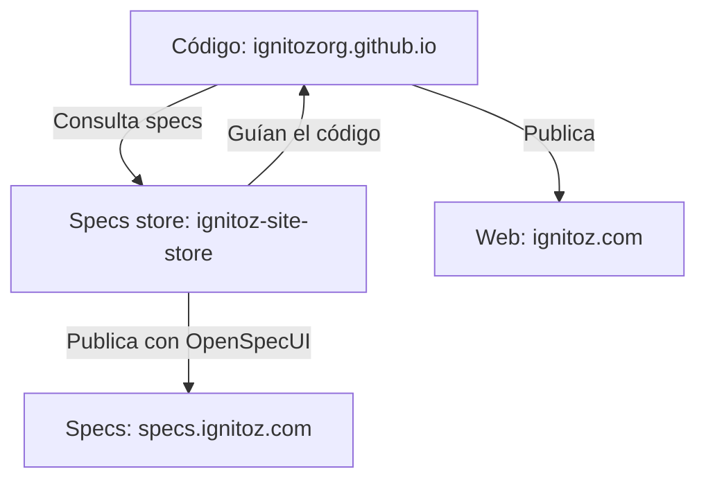

# Ignitoz Site Store

Repositorio de especificaciones de la web de **Ignitoz**. Aquí se documentan el comportamiento esperado del sitio, las decisiones de diseño y el historial de cambios mediante OpenSpec.

**[Consultar las especificaciones](https://specs.ignitoz.com)** · **[Visitar Ignitoz](https://ignitoz.com)** · **[Ver el código de la web](https://github.com/IgnitozOrg/ignitozorg.github.io)**

## Código y especificaciones en repositorios separados

| Repositorio | Responsabilidad | Publicación |
| --- | --- | --- |
| [`ignitozorg.github.io`](https://github.com/IgnitozOrg/ignitozorg.github.io) | Código de la aplicación, recursos y pruebas de la web | `ignitoz.com` |
| [`ignitoz-site-store`](https://github.com/IgnitozOrg/ignitoz-site-store) | Especificaciones, propuestas, diseños y tareas de OpenSpec | `specs.ignitoz.com` |

Esta separación permite revisar qué debe hacer el producto y por qué se decidió un cambio, mientras la implementación evoluciona en su propio repositorio. Cada repositorio conserva sus commits y su publicación.



El código referencia el store mediante OpenSpec; las especificaciones del store definen el comportamiento que debe implementar el código.

Ambos repositorios tienen una publicación independiente: la aplicación en `ignitoz.com` y las specs en `specs.ignitoz.com`. OpenSpecUI genera la versión estática de las specs.

### Cómo se vinculan

El repositorio de código declara el store en su archivo `openspec/config.yaml`:

```yaml
schema: spec-driven
store: ignitoz-site-store
```

Este repositorio identifica ese mismo store en [`.openspec-store/store.yaml`](.openspec-store/store.yaml):

```yaml
version: 1
id: ignitoz-site-store
```

El entorno de desarrollo debe tener configurado el acceso y la resolución de ese store para trabajar desde el repositorio de código. El identificador establece la asociación; no configura una sincronización automática entre ambos repositorios.

La web pública de especificaciones es una exportación estática para consulta. Actualizar una especificación no modifica ni despliega la aplicación: los cambios de implementación se realizan y validan en el repositorio de código.

## Qué encontrarás aquí

```text
.openspec-store/store.yaml   Identidad del store
openspec/
  config.yaml               Contexto y reglas de documentación
  specs/                    Especificaciones vigentes
  changes/                  Propuestas, diseños y tareas de cambios
    archive/                Historial de cambios archivados
.github/workflows/
  deploy-pages.yml           Publicación de las especificaciones
```

Las especificaciones actuales cubren la sección de últimos videos de YouTube, las reglas de calidad del código y la gestión de dependencias de la aplicación. Los archivos de diseño pueden mencionar rutas del repositorio de código.

## Flujo de trabajo

1. Documentar el cambio con OpenSpec: propuesta, especificaciones, diseño y tareas según corresponda.
2. Implementar el comportamiento y ejecutar las validaciones en `ignitozorg.github.io`.
3. Mantener las especificaciones vigentes y archivar el cambio cuando se complete.
4. Revisar y guardar los cambios en cada repositorio. Conviene enlazar sus PR o issues para conservar la trazabilidad.

## Consultar localmente

Usa Node.js 24, como el workflow de publicación.

```sh
npm ci
npm start
```

`npm start` abre OpenSpecUI para explorar el contenido de este repositorio. La configuración de `.npmrc` mantiene desactivados los scripts automáticos de instalación.

Para generar la versión estática:

```sh
npm run build
```

El resultado queda en `dist/`, con base `/` para el subdominio `specs.ignitoz.com`.

## Publicación

El [workflow de GitHub Actions](.github/workflows/deploy-pages.yml) se ejecuta al hacer push a `main` o iniciarlo manualmente. Instala las dependencias, exporta el contenido con OpenSpecUI y publica `dist/` en GitHub Pages.

El dominio personalizado se configura en **Settings → Pages** del repositorio. Cloudflare resuelve `specs.ignitoz.com` mediante un CNAME hacia `ignitozorg.github.io` con **DNS only**. GitHub Pages aloja la documentación y sirve HTTPS.
